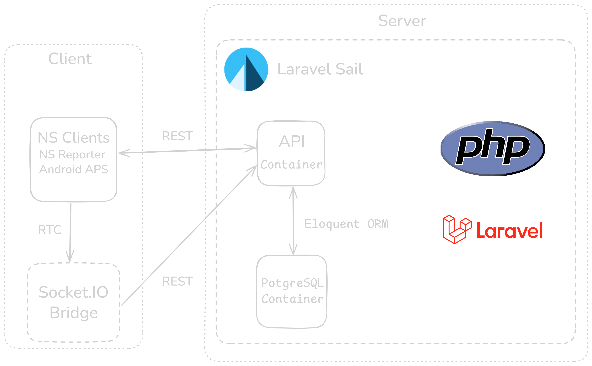
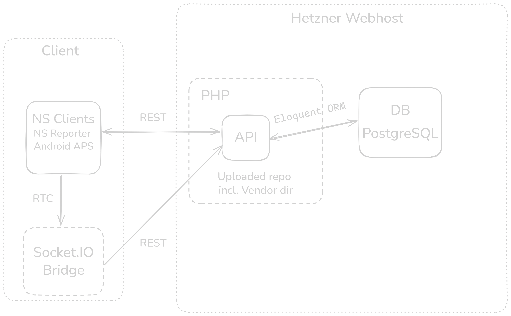

# Nightscout Laravel API

A lightweight, Nightscout-compatible API in PHP (Laravel) that supports AndroidAPS.

---

## Project Description

Implements middleware in PHP that accepts requests to the Nightscout API and translates them into SQL database queries.
The middleware maintains the database according to API requests. The technology stack is chosen for cost-effective
hosting.

This project simulates the Nightscout API with Laravel and replaces MongoDB with SQL compatibility. It is built to
connect with AndroidAPS.

---

## Functional Requirements

- Implementation of the Nightscout V1 REST API in PHP
- Read requests must be available in the same formats as Nightscout (JSON, line-by-line output, etc.)
- PHP implementation of a document database emulation
- Creation of a test program to interact with the API (preferably using Swagger)

---

## Constraints

- The code must run on a classic web host (tested on Hetzner)
- The execution time of a write request—even with very large databases—must not exceed a few seconds (maximum 1 minute)
- The execution time of a read request with common search parameters must also only take a few seconds

---

## Optional Requirements (for higher grades)

- Demonstration with AndroidAPS as data source and nightscout-reporter as user interface → https://nightrep.zreptil.de/
- Implementation of auth tokens
- Support for Nightscout API V3
- Encapsulation of the database emulation as a standalone library including optimization

---

## Non-Functional Requirements

- Provision of a script to import datasets from a MongoDB
- Report on the experiments conducted and design decisions
- Documentation of the technologies used, so other students can easily get started
- Result logging and precise documentation of outcomes
- Provision of a prototype with detailed documentation for setup
- Provision of a Dockerfile and a docker-compose.yml

---

## Docs

- Open API documentation available in [swagger.yaml](./docs/swagger/swagger.yaml)
- Postman collection available in [postman_collection.json](./docs/postman/postman-collection.json)
- Additional project documentation can be found in [docs/README.md](docs/README.md)
- [Node.js Socket.IO Bridge](https://code.fbi.h-da.de/pse_nightscout/aaps-laravel-bridge) for real-time communication with AndroidAPS
---

## Getting Started

You can get the application up and running in two ways: using Docker (recommended) or setting it up locally.

---

### With Docker (Recommended)

This is the easiest way to get started, as it handles all the dependencies for you.

**Prerequisites:**
- Docker
- Composer
- PHP 8.1 or higher



**1. Clone the Repository**
```bash
git clone https://code.fbi.h-da.de/pse_nightscout/nightscout_api.git
cd nightscout_api
```

**2. Install Dependencies & Configure Environment**
```bash
# Copy the example environment file
cp .env.example .env


# This command installs PHP dependencies required to run Sail
composer install
```

**3. Start the Application with Sail**
```bash
# Start the Docker containers in the background
./vendor/bin/sail up -d
```

**4. Finalize Setup**
```bash
# Generate the application key
./vendor/bin/sail artisan key:generate

# Run database migrations to create the necessary tables
./vendor/bin/sail artisan migrate
```

Your Nightscout API is now running and available at `http://localhost:80`.

**Useful Sail Commands:**
- Stop the application: `./vendor/bin/sail stop`
- Run any artisan command: `./vendor/bin/sail artisan <command>`
- Run composer commands: `./vendor/bin/sail composer <command>`

For more information, see the [Laravel Sail documentation](https://laravel.com/docs/12.x/sail).

---

### Locally

If you prefer not to use Docker, you can set up the project on your local machine.

**Prerequisites:**
- PHP 8.1 or higher
- Composer
- A database server (e.g., MySQL, PostgreSQL)

**1. Clone the Repository**
```bash
git clone https://code.fbi.h-da.de/pse_nightscout/nightscout_api.git
cd nightscout_api
```

**2. Install Dependencies & Configure Environment**
```bash
# Install PHP dependencies
composer install

# Copy the example environment file and generate a key
cp .env.example .env
php artisan key:generate
```

**3. Configure Your Database**
Open the `.env` file and update the `DB_*` variables to match your local database credentials:
```env
DB_CONNECTION=pgsql
DB_HOST=127.0.0.1
DB_PORT=5432
DB_DATABASE=your_db_name
DB_USERNAME=your_db_user
DB_PASSWORD=your_db_password
```

**4. Run Migrations**
This will create all the necessary tables in your database.
```bash
php artisan migrate
```

**5. Start the Development Server**
```bash
php artisan serve
```
Your Nightscout API is now running and available at `http://localhost:8000`.

---

### Production (Hetzner Shared Hosting)

Deploying to a shared host like Hetzner requires a manual process since you don't have SSH access to run `composer` or `artisan` commands directly on the server.

**Prerequisites:**
- A Hetzner Webhosting Package (Level 1 or higher)
- FTP client (e.g., FileZilla)
- Local setup of the project (as described above)



**Deployment Steps**

The core idea is to prepare the application locally, upload all files (including dependencies) via FTP, and configure the remote server to point to the correct directory.

**1. Prepare Your Application Locally**

First, you need to get your application into a "production-ready" state.

```bash
# Install only production dependencies and optimize the autoloader
composer install --optimize-autoloader --no-dev

# Cache your configuration and routes for better performance
php artisan config:cache
php artisan route:cache
```

**2. Configure Your Hetzner Database**

1.  Log in to your Hetzner (KonsoleH) control panel.
2.  Navigate to the database section and create a new PostgreSQL database.
3.  Take note of the **Database Name**, **Username**, **Password**, and **Hostname** (usually `localhost` or a specific server address).

**3. Run Migrations on the Remote Database**

You will run the database migration from your local machine, but point it to the Hetzner database. This is a clever workaround for not having SSH access.

1.  Open your local `.env` file.
2.  Temporarily change the `DB_*` variables to match the credentials of your **Hetzner database**.
    ```env
    DB_HOST=your_hetzner_db_host
    DB_DATABASE=your_hetzner_db_name
    DB_USERNAME=your_hetzner_db_user
    DB_PASSWORD=your_hetzner_db_password
    ```
3.  Run the migrate command from your local terminal:
    ```bash
    php artisan migrate
    ```
4.  **Important:** After the migration is complete, revert the changes in your local `.env` file to your local database credentials.

**4. Upload Files via FTP**

1.  Connect to your Hetzner webspace using your FTP client.
2.  Upload your **entire project directory** (including the `vendor` folder but excluding the `.git` directory and local `.env` file) to the server. This can take a significant amount of time due to the large number of files.

**5. Configure the Document Root**

Hetzner's web server needs to point to the `public` directory of your Laravel application. This is the most secure way to run a Laravel application, as it prevents web access to your application's root directory.

1.  In your Hetzner control panel, go to **Domains**.
2.  Select your domain and find the **Document Root** or **Path** setting.
3.  Change the path to point to your project's `public` folder. For example, if you uploaded your project to the root directory and its name is `nightscout_api`, the path should be `/nightscout_api/public`.

**Note:** If you cannot change the document root, you would need to restructure your application by moving files from the `public` directory into your host's web root (e.g., `public_html`) and adjusting the paths in `index.php`. This is not recommended. The method described above is the standard and most secure practice.

**6. Final Configuration**

1.  Using your FTP client, navigate to the uploaded project directory on the server.
2.  Rename the `.env.example` file to `.env`.
3.  Edit the `.env` file and fill in the `APP_URL` and the `DB_*` variables with your Hetzner domain and database credentials. Make sure `APP_ENV` is set to `production` and `APP_DEBUG` is `false`.
    ```env
    APP_ENV=production
    APP_DEBUG=false
    APP_URL=https://your-domain.com

    DB_CONNECTION=pgsql
    DB_HOST=your_hetzner_db_host
    DB_DATABASE=your_hetzner_db_name
    DB_USERNAME=your_hetzner_db_user
    DB_PASSWORD=your_hetzner_db_password
    ```
4.  Set the correct file permissions. Using your FTP client, set the permissions for the following directories to `775`:
    *   `storage`
    *   `bootstrap/cache`

Your Nightscout API should now be live on your Hetzner hosting. To update the application, you will need to repeat the steps of preparing the app locally and uploading the changed files via FTP.

**7. Important Considerations for Shared Hosting**
- **Artisan Commands:** You cannot run `php artisan` commands directly on the server without SSH access. Any commands like `migrate`, `config:cache`, etc., must be run locally and the resulting files uploaded.
- **Queues & Scheduling:** This setup does not support Laravel's queue workers. If you need to run scheduled tasks, you must configure a Cron Job through your Hetzner control panel to call a specific URL or script.
- **Storage:** Ensure your application is configured to use the `local` file storage driver. Other drivers like S3 or Redis will not work in this environment.


---

## Supported API Endpoints

| Category       | Path                            |
|----------------|---------------------------------|
| Entries        | `/api/entries`                  |
| Treatments     | `/api/treatments`               |
| DeviceStatus   | `/api/devicestatus`             |
| Profile        | `/api/profile`, `/profiles`     |
| Status         | `/api/status`                   |
| Activity       | `/api/activity`                 |
| Notifications  | `/api/notifications/*`          |
| AdminNotifies  | `/api/adminnotifies`            |
| VerifyAuth     | `/api/verifyauth`               |
| Alexa / Google | `/api/alexa`, `/api/googlehome` |
| Root           | `/api/versions`                 |

---

## Structure

```bash
app/Http/Controllers/       # All API controllers
routes/api.php              # All API routes (Nightscout-compatible)
storage/debug/              # JSON files for stored data
```

---

## Project Team

- [**Omar Ibrahim Arfa**](@stomarfaa)
- [**Elyes Lachal**](@stellach)
- [**Simon Pototzki**](@stsipotot)
- [**Krystian Sadlo**](@istkrsadl)
- [**Aiham Zaria**](@staizari)
